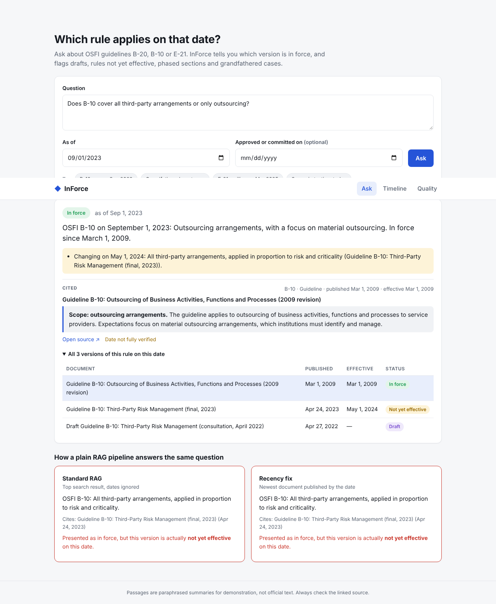

# InForce

**Answers about banking regulations that know which version actually applies on a given date.**

Standard RAG systems treat a rule as either old or new. Real regulations are messier: consultation drafts sit next to
finals, finals are published a year before they take effect, sections phase in on different dates, and some old rules
still apply to commitments made before a change. InForce models those states explicitly and measures how often a
normal RAG pipeline gets them wrong.

On the 27-question seed set:

| Strategy | Correct | Confidently stale* |
| --- | --- | --- |
| Standard RAG (top BM25 hit, dates ignored) | 37% | 67% |
| Recency fix (newest document published by the date) | 59% | 37% |
| **InForce lifecycle resolver** | **100%** | **0%** |

\*Presented the answer as in force, but the cited version was a draft, superseded, or not yet effective on that date.

> **Read the caveat:** InForce reads curated effective dates, and the questions were written against the same corpus.
> The 100% shows the resolver logic is correct when metadata is right. The real research question, and the next
> milestone, is accuracy when effective dates must be extracted from documents automatically.



## What it does

- **Ask with a date.** Pick an as-of date and, optionally, when a mortgage or arrangement was approved. The answer
  shows a status badge (*In force*, *Not yet effective*, *Draft*, *Superseded*, *Grandfathered*), cites the
  clause, flags upcoming changes, and shows how standard RAG and a recency fix would have answered.
- **Timeline.** Every version of each rule on a time axis, coloured by its state on the selected date, plus a
  watchlist stored in Postgres.
- **Quality dashboard.** The evaluation set scored for all three strategies, by question type and per question.

Lifecycle states covered by the seed corpus (OSFI B-20, B-10, E-21):

| State | Example |
| --- | --- |
| Draft vs. final | B-10 draft (Apr 2022) before the final (Apr 2023) |
| Published, not yet effective | B-10 final published Apr 24, 2023, effective May 1, 2024 |
| Phased by section | E-21 sections effective Aug 2024, Sep 2025, Sep 2026; scenario testing Sep 2027 |
| Grandfathered | B-20 pre-approvals before Jun 1, 2021 may use the prior qualifying rate |
| Reconfirmed unchanged | B-20 December 2021 annual review restates the same rate |

## Architecture

```
Browser ──▶ web (Next.js 15, TypeScript)
              │  /api/* same-origin proxy
              ▼
            api (Spring Boot 3.3, Java 21) ──▶ Postgres 16 (watchlist, Flyway migrations)
              │  validation, error mapping, health checks
              ▼
            ml-service (FastAPI, Python)
              BM25 retrieval → rule identification → lifecycle resolver → answer + citations
              evaluation harness (python -m inforce.evaluate)
```

| Folder | What is in it |
| --- | --- |
| `ml-service/` | Corpus loader with validation, lifecycle resolver, BM25 retriever, 3 answer strategies, eval harness, 27 pytest tests |
| `ml-service/data/` | `corpus.json` (16 passages, 10 documents) and `questions.json` (27 questions) |
| `api/` | Spring Boot gateway: `/api/ask`, `/api/regulations`, `/api/eval`, `/api/watchlist`, RFC 9457 errors, 6 integration tests |
| `web/` | Next.js app (Ask, Timeline, Quality) and a Playwright UI smoke test |
| `deploy/helm/inforce/` | Helm chart for Kubernetes |
| `.github/workflows/ci.yml` | Tests for all three services; fails if the resolver regresses |

## Run it

### Docker Compose

```bash
docker compose up --build
# open http://localhost:3000
```

### Without Docker

Requires Python 3.12+, Java 21, Maven, Node 22 and a Postgres database named `inforce` (user and password `inforce`).

```bash
# 1. ML service
cd ml-service && python -m venv .venv && . .venv/bin/activate
pip install -r requirements-dev.txt
uvicorn inforce.api:app --port 8000

# 2. API (new terminal)
cd api && mvn spring-boot:run

# 3. Web (new terminal)
cd web && npm install && npm run dev      # http://localhost:3000
```

### Tests

```bash
cd ml-service && pytest -q && python -m inforce.evaluate
cd api && mvn test
cd web && npm run lint && npm run build
# UI smoke test against a running stack (uses installed Chrome):
cd web && PW_CHANNEL=chrome npm run test:ui
```

### Kubernetes

Build and push the three images as `inforce-ml`, `inforce-api` and `inforce-web`, create a secret `inforce-db`
with key `password`, then:

```bash
helm install inforce deploy/helm/inforce --set imageRegistry=ghcr.io/<you> --set database.url=jdbc:postgresql://<host>:5432/inforce
```

## API

| Method | Path | Notes |
| --- | --- | --- |
| POST | `/api/ask` | `{question, asOf?, mode?: lifecycle\|recency\|baseline, commitmentDate?}` |
| GET | `/api/regulations` | Regulations, their rules and documents |
| GET | `/api/regulations/{id}/timeline?asOf=` | Every version with its status on the date |
| GET | `/api/eval` | Full evaluation report |
| GET/POST/DELETE | `/api/watchlist[/{id}]` | Watchlist (Postgres) |
| GET | `/actuator/health` | Includes database and ML service status |

## Data and honesty notes

- Passages are **short paraphrased summaries written for this project**, not official text. Each links to its source.
  OSFI material may be reproduced for non-commercial purposes only with permission, so the repo ships summaries and links.
- Each document carries a `verification` field. Dates marked approximate (for example the 2016 E-21 and 2009 B-10 days)
  are shown with a warning in the UI. Check them before relying on them.
- Answers are generated from templates, not an LLM, so every sentence is traceable to a passage.

## Roadmap

1. Grow the corpus to 4–6 regulations and about 300 questions with a second reviewer.
2. Extract effective dates and section phases automatically, then measure how resolver accuracy degrades with noisy metadata.
3. Add dense retrieval (Cohere Embed or an open model) and a reranker; train a version-aware reranker with stale passages as hard negatives.
4. Optional LLM answer generation (Cohere Command) constrained to the resolved passage, scored with the same harness.
5. Change alerts: scheduled crawl of OSFI pages, version diff, notify watchers.
